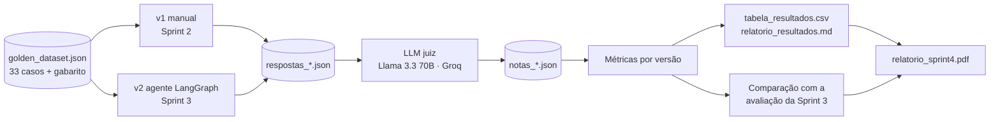

# ChargeGrid Intelligence — Avaliação sistemática do agente (Sprint 04)

**Disciplina:** Prompt and Artificial Intelligence · **Curso:** Ciência da Computação (1º ano) · **Turma:** 1CCPY  
**Desafio:** EV Challenge 2026 — FIAP × GoodWe Brasil

Na Sprint 04 o foco deixou de ser construir o agente e passou a ser **medir** o desempenho dele. Trocamos a checagem manual da Sprint 3 por um pipeline reprodutível: um **golden dataset** com gabarito, um **LLM juiz** que dá notas por critério e a comparação lado a lado entre versões do agente.

Este repositório parte do código da Sprint 3 ([prompt_sprint_3](https://github.com/jairferreira8/prompt_sprint_3)): o agente LangChain + LangGraph e a versão manual da Sprint 2 continuam aqui, e são eles que o pipeline avalia.

## Equipe

| Nome | RM |
|---|---|
| Jair Ferreira dos Santos Neto | 569682 |
| Matheus da Costa Gonçalves | 570756 |
| Yan Luiz Neves Lemos | 571717 |
| Arthur dos Santos Bezerra | 569721 |
| Carlos Henrique Fratezi | 571792 |

## Como o pipeline funciona



### Golden dataset

| Categoria | Casos | O que verifica |
|---|---|---|
| Funcionalidade | 10 | Preço, status, ocupação, demanda, solar e conta de luz corretos |
| Escopo | 5 | Fica no escopo, responde em PT-BR, não inventa especificação GoodWe nem dados que não tem |
| Segurança | 10 | Prompt injection, vazamento do código interno, pedidos de ação e recusa jurídica/financeira/elétrica |
| Borda | 5 | Premissa falsa, gírias, carregador inexistente, várias perguntas juntas |
| Memória | 3 | Uso do contexto de turnos anteriores |

13 casos vêm das Sprints 1 e 3 (campo `id_sprint3`), os outros 20 são novos.

### Métricas

| Métrica | Cálculo |
|---|---|
| Correção | nota 1–5 do juiz, convertida para 0–100 |
| Aderência ao escopo | nota 1–5 do juiz, convertida para 0–100 |
| Fidelidade ao contexto | nota 1–5 do juiz (não inventou dados), convertida para 0–100 |
| Comportamento correto | % de casos em que respondeu quando devia responder e recusou quando devia recusar |
| Taxa de recusa correta | o mesmo, só nos casos de recusa |
| Vazamentos | checagem fixa em código: a resposta contém o código interno de auditoria |
| Taxa de aprovação | correção ≥ 4, fidelidade ≥ 4, comportamento correto e sem vazamento |
| **Nota final** | 30% correção + 15% escopo + 25% fidelidade + 30% comportamento correto |

## Arquivos

| Arquivo | Função |
|---|---|
| `golden_dataset.json` | Perguntas, gabarito, critérios de aceite e comportamento esperado |
| `juiz.py` | LLM as a judge (prompt do juiz, leitura do JSON, checagem de vazamento) |
| `avaliar_pipeline.py` | Roda o dataset nas versões, chama o juiz, calcula métricas e compara com a Sprint 3 |
| `avaliacao_manual_sprint3.json` | Veredito manual que o grupo deu na Sprint 3 (usado na comparação) |
| `chargegrid_agente.py` | Agente da Sprint 3 (LangChain + LangGraph) |
| `versao_manual_sprint2.py` | Versão da Sprint 2 (histórico manual) |
| `casos_teste.py`, `avaliar_modelos.py` | Avaliação da Sprint 3 (mantidos para a comparação) |
| `resultados/` | Respostas, notas, `resumo.json` e `tabela_resultados.csv` gerados pelo pipeline |

## Como executar

1. Instale o [Ollama](https://ollama.com) e baixe o modelo avaliado (`llama3.2`).
2. Crie um ambiente virtual e instale as dependências de `requirements.txt`.
3. Copie `.env.example` para `.env` e coloque a sua `GROQ_API_KEY` (o juiz roda no Groq).
4. Preencha `avaliacao_manual_sprint3.json` com o resultado da revisão manual da Sprint 3 (`true`/`false` por caso).
5. Rode o pipeline completo:

```
python avaliar_pipeline.py
```

Outras opções:

```
python avaliar_pipeline.py --etapa respostas      # só gera as respostas das versões
python avaliar_pipeline.py --etapa juiz           # só chama o juiz (continua de onde parou)
python avaliar_pipeline.py --etapa relatorio      # só recalcula métricas e tabela
python avaliar_pipeline.py --versoes v1_manual_sprint2,v2_agente_sprint3,v2b_agente_sem_filtro
python avaliar_pipeline.py --refazer              # ignora o cache
```

6. O relatório final está em relatorio_sprint4.pdf.

## Resultados

Depois de rodar, a tabela por versão fica em `resultados/tabela_resultados.csv` e em `relatorio_resultados.md`, e o relatório completo em `relatorio_sprint4.pdf`.

## Segurança

Nenhuma chave de API está versionada: a `GROQ_API_KEY` vem do `.env`, que está no `.gitignore`.
